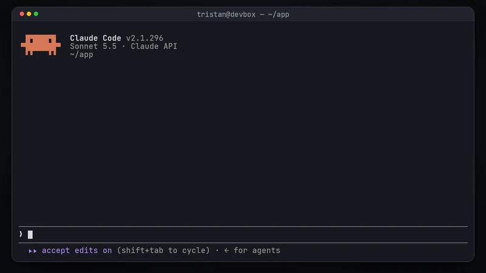

# sub-human

> **v2 is in progress.** This branch is a rebuild from the 0.8 proof of concept and is not yet usable. The design is in
> [docs/PRD.md](docs/PRD.md), [docs/ARCHITECTURE.md](docs/ARCHITECTURE.md) and [docs/TESTING.md](docs/TESTING.md).
> The last released version is 0.8.1, in git history.

**Subagents, but for humans.** A Claude Code plugin for people who work together, each with their own Claude.

Everyone keeps their own terminal, repo, login and Claude. sub-human keeps each of you, and each of your Claudes, up
to date with what the others' sessions learn, decide and change, as it happens, without anyone writing a status update
or copying between chats.

## Why

Claude Code is great with one person and many agents. But most software is built by a few people, and when each of us
has a Claude, the people and the Claudes still coordinate by copying and pasting between chats.

**How it differs** from other ways to share Claude Code:

- **Not one shared session.** Nobody types into someone else's Claude.
- **Not a context export.** The work is shared live, as it happens.
- **Only you can agree for you.** No Claude agrees to a plan for its person.
- **No server.** A room lives on the machine that opened it; others reach it over Tailscale or ssh. No telemetry.

## More

- [SECURITY.md](SECURITY.md): how to report a vulnerability.
- [CONTRIBUTING.md](CONTRIBUTING.md).

MIT licensed. See [LICENSE](LICENSE).
